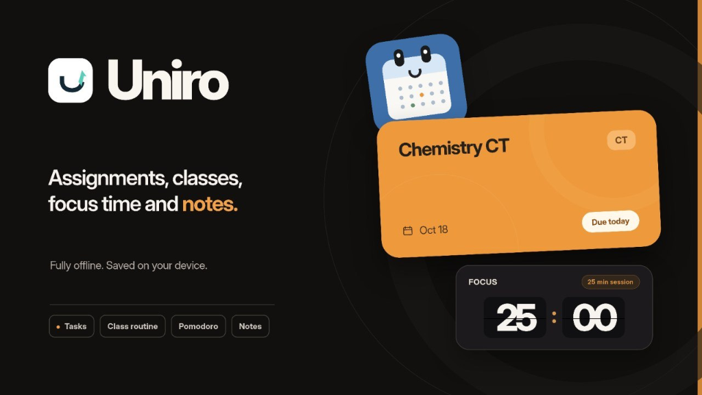
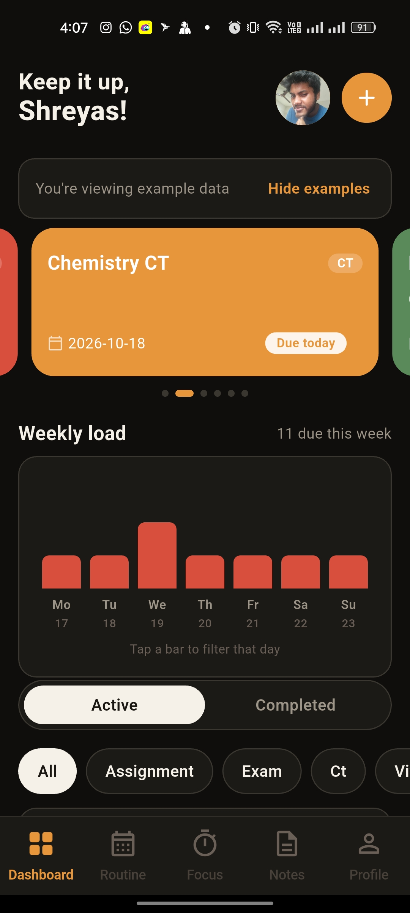
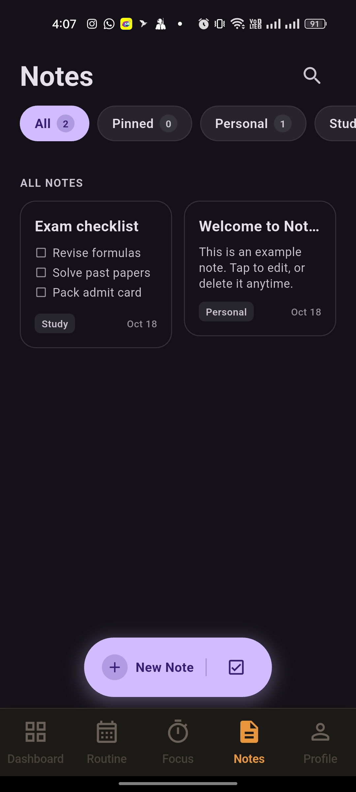
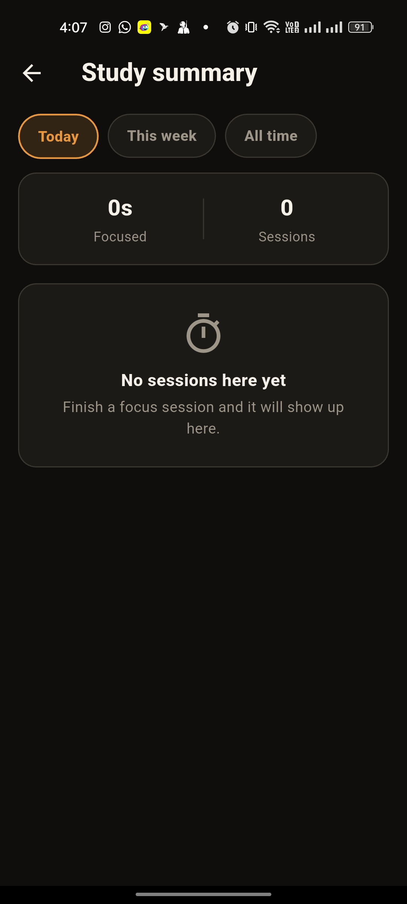
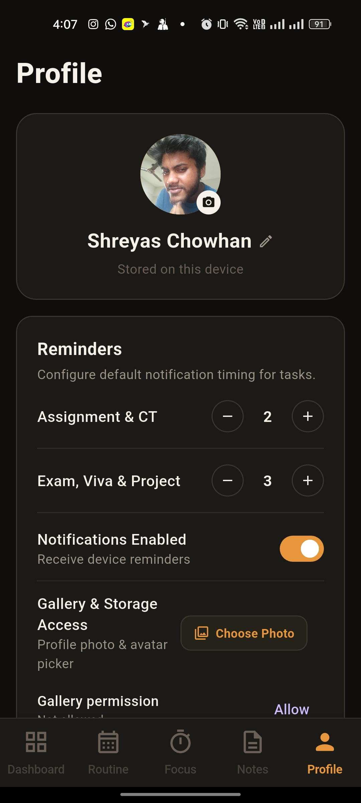
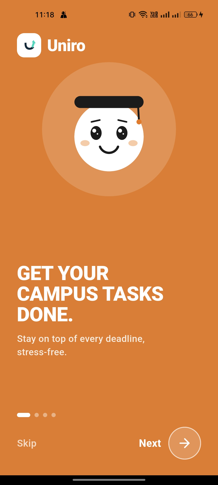
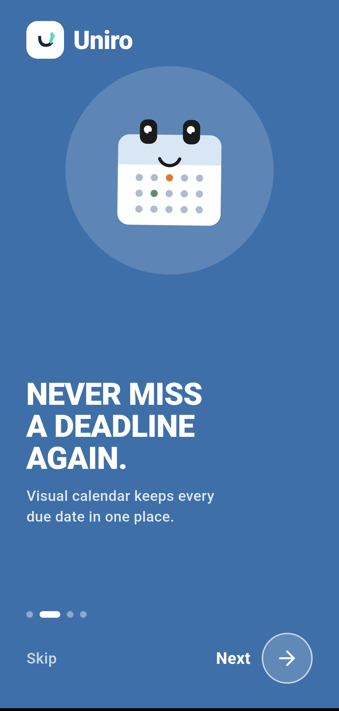
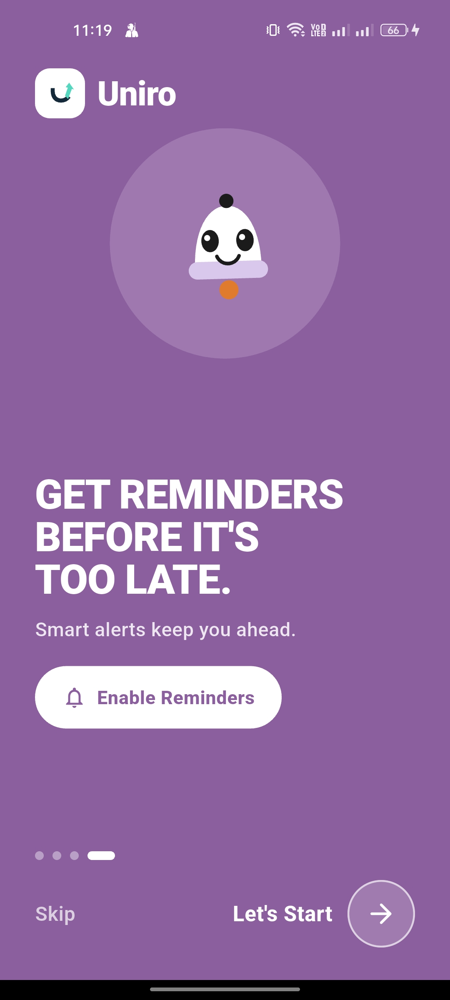

<p align="center">
  
</p>

#  Uniro

<p>
  <strong>Your all-in-one offline campus companion for university life.</strong><br>
  Stay on top of every deadline, class routine, focus session, and lecture note — completely offline, private, and distraction-free.
</p>

<p>
  <a href="https://github.com/sudoguy47/Uniro/releases/latest"></a>
  
  
  
  <a href="LICENSE"></a>
</p>

---

## 📸 Screenshots

### Main Experience
| 📊 Dashboard | 📝 Rich Notes | ⏱️ Focus Summary | 👤 Profile & Settings |
|:---:|:---:|:---:|:---:|
|  |  |  |  |

### Smooth Onboarding
| 🚀 Campus Tasks | 📅 Visual Schedule | 🔔 Smart Reminders |
|:---:|:---:|:---:|
|  |  |  |

---

## ✨ Features at a Glance

### 📊 Smart Dashboard
- **Contextual Greetings** — Personalized time-of-day greetings across 7 time brackets (Rise & Shine, Good Morning, Afternoon Grind, Midnight Study).
- **Daily Fuel Quotes** — 12 deterministic study quotes that rotate automatically each day without internet.
- **Hero Task Carousel** — Swipeable 4-second auto-advancing cards highlighting your closest upcoming deadlines.
- **Weekly Load Chart** — 7-bar visual breakdown of due tasks for Monday–Sunday. Tap any bar to instantly filter that day.
- **Next Class Alert** — Live countdown card informing you of your immediate upcoming lecture room and timing.

### 📅 Task & Deadline Management
- **Academic Categorization** — 9 specialized categories: *Assignment, Exam, Class Test (CT), Viva, Presentation, Lab, Project, Other,* and *Custom*.
- **Smart Reminders** — Schedule alerts *At time of event, 1 hour before, 1 day before, 3 days before, 1 week before,* or set a *Custom N-days* stepper.
- **Urgency Highlights** — Visual urgency badges:
  - 🔴 **Overdue** (`#D94F3D`)
  - 🟠 **Due Today** (`#E8963C`)
  - 🟢 **Upcoming** (`#5A8A5A`)
- **Instant Completion** — One-tap completion with immediate haptic response. Cancelled alerts are cleared automatically.

### ⏰ Class Routine & Schedule
- **Weekly Timetable** — Manage recurring classes with time windows, course codes, instructors, and room numbers.
- **Conflict Prevention** — Built-in overlap detection warns you if two classes collide.
- **Class Reminders** — Automated alerts 15 minutes prior to every lecture so you never run late.

### ⏱️ Pomodoro Focus Timer
- **Split-Flap Flip Clock** — Sleek mechanical flip-card aesthetic designed for zero-distraction study sprints.
- **Flexible Modes** — Standard Pomodoro (work + auto break), single countdown block, or count-up stopwatch.
- **Course & Task Linking** — Tag your study sessions to specific courses to track where your hours go.
- **Session History** — Automatically logs completed focus blocks into an aggregated study summary.

### 📝 Rich Block Notes
- **Modular Block Editor** — Flexible paragraphs, animated interactive checklists, and styled quote bubbles.
- **Inline Formatting** — Bold, italic, color highlights, custom text sizing, and text alignment.
- **Folder Organization** — Group notes into *Personal, Study, Work,* or create your own custom folders.
- **500ms Autosave** — Instant debounce autosave protects your notes against app exits or low-battery shutdowns.
- **Undo Protection** — 4-second safety Snackbar with one-tap restore if you accidentally delete a note.

### 🔔 Reliable Notifications & Alarms
- **Exact Alarms** — Utilizes Android's `AlarmManager.setExactAndAllowWhileIdle` for dependable notifications.
- **Morning 6:00 AM Briefing** — Daily morning motivation alert with 30 rotating life quotes (`id: 900001`).
- **Reboot Resilience** — Automatically re-arms all pending task and class alarms upon phone reboot (`BOOT_COMPLETED`), timezone change, or system clock update.

### 📱 Home-Screen Widgets
- **Weekly Load Widget** — 560×160 graphic bar chart of your upcoming 7-day workload and immediate next task.
- **Monthly Heatmap Widget** — Calendar matrix featuring activity streak dots.

### 🎨 Personalization & Theme
- **Warm Paper Aesthetic** — Hand-crafted color palette (`#EDE8DF` Light / `#0F0E0C` Dark) easy on student eyes.
- **Theme Modes** — One-tap toggle between Light, Dark, or System default.
- **Profile Customization** — Custom profile avatar with initial-letter fallback and editable student name.
- **OEM Battery Guide** — Step-by-step tips for strict background-killing devices (Xiaomi, Oppo, Realme, Vivo, Samsung).

---

## 🔒 Privacy First

- **100% On-Device:** All tasks, routines, notes, and preferences live solely on your phone's local storage.
- **No Sign-Up:** No email, phone number, password, or third-party account required.
- **Zero Analytics:** No tracking SDKs, no ad networks, no data harvesting.
- **Offline Reliability:** Operates with 100% functionality without mobile data or Wi-Fi.

---

## 📥 Installation

1. Grab the latest APK from the [GitHub Releases](https://github.com/sudoguy47/Uniro/releases/latest) page.
2. Open the downloaded file on your Android device.
3. Allow *"Install unknown apps"* if prompted by your browser/file manager.
4. Open **Uniro** and enjoy your productive campus journey!

> **Note:** The official application package is `dev.sudoguy.uniro`.

---

## 🛠️ Build from Source

### Prerequisites
- [Flutter SDK](https://docs.flutter.dev/get-started/install) (v3.24+ recommended)
- [Android Studio](https://developer.android.com/studio) / Android SDK (API 34+)

```bash
# Clone the repository
git clone https://github.com/sudoguy47/Uniro.git
cd Uniro

# Install dependencies
flutter pub get

# Run static analysis & tests
flutter analyze
flutter test

# Build debug APK
flutter build apk --debug

# Build production release APK
flutter build apk --release
```

---

## 🛡️ Android Permissions

| Permission | Purpose |
|---|---|
| `POST_NOTIFICATIONS` | Delivers task deadline alerts, class reminders, and the 6:00 AM morning fuel quote. |
| `SCHEDULE_EXACT_ALARM` | Guarantees alarms fire on the exact minute, even when the device is in Doze mode. |
| `RECEIVE_BOOT_COMPLETED` | Automatically reschedules all your alarms after device restart. |
| `VIBRATE` | Provides soft tactile feedback on taps and notification vibration. |
| `READ_MEDIA_IMAGES` | Optional: lets you select a local photo for your profile avatar. |

---

## 📄 License

This project is open-source and available under the [MIT License](LICENSE).  
Copyright (c) 2026 **sudoguy47**.
